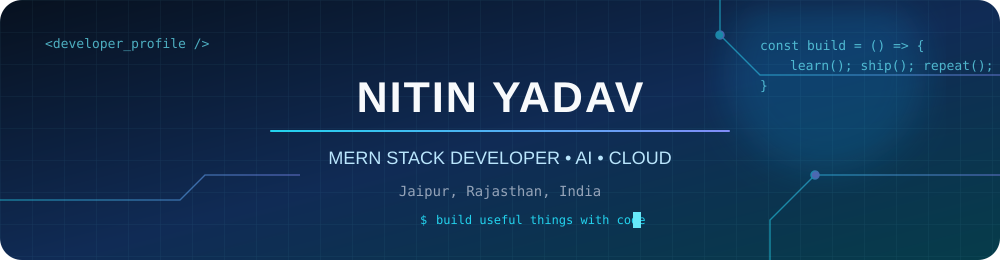
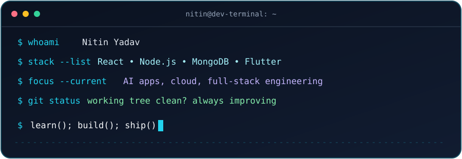

---

## `whoami` — About Me

I'm **Nitin Yadav**, a BCA student and developer from Jaipur, Rajasthan, India. I build web and mobile applications and explore how AI integrations, APIs, databases, and cloud services can solve practical problems.

- 🎓 **Education:** BCA, S.S. Jain Subodh PG (Autonomous) College, Jaipur
- 💼 **Experience:** Gen AI & Cloud Computing Intern, BharatCares® — IBM SkillsBuild Academic Internship 2026
- 🔭 **Currently exploring:** Full-stack engineering, Generative AI, LLM applications, cloud deployment, and cybersecurity
- 🎯 **Goal:** Build reliable and useful software while growing as an engineer

---

## 💻 Live Coding Terminal

---

## ⚙️ Tech Stack

**AI & APIs:** Generative AI, LLMs, Prompt Engineering, Grok API, REST APIs, Axios, Cheerio  
**Cloud:** AWS, Google Cloud Platform  
**Development:** Full-stack web apps, mobile apps, API integration, database design

---

## 🚀 Featured Projects

<table>
<tr>
<td width="50%" valign="top">

### 🛡️ GhostAudit
**Cloud Security & IAM Analysis**

Cybersecurity project focused on cloud identity and access analysis.

</td>
<td width="50%" valign="top">

### ☸️ AKS Access Debt Agent
**Kubernetes Access Governance**

Project exploring access-debt analysis in an Azure Kubernetes Service (AKS) context.

</td>
</tr>
<tr>
<td width="50%" valign="top">

### 🇮🇳 SarkarSetu AI
**AI-Powered Government Scheme Discovery**

Mobile app in progress to help users discover relevant government welfare schemes through personalized recommendations, eligibility guidance, multilingual assistance, and deadline alerts.

**Stack:** Flutter, Node.js, Express.js, MongoDB, Grok API, Axios, Cheerio.

</td>
<td width="50%" valign="top">

### 🔐 BehaviorAuth MimicGuard
**Behavioral Biometric Authentication**

Authentication project using typing rhythm, key intervals, mouse movement, and interaction patterns as an additional verification layer.

**Stack:** React.js, Tailwind CSS, Node.js, Express.js, MongoDB Atlas.

</td>
</tr>
</table>

---

## 💼 Experience

**Gen AI & Cloud Computing Intern — BharatCares®**  
*IBM SkillsBuild Academic Internship 2026 · Remote · June–July 2026*

- Built AI-powered applications using Generative AI, prompt engineering, and LLM concepts.
- Applied cloud computing, API architecture, and data persistence concepts while deploying AI applications on AWS.
- Completed project-based learning through IBM’s Digital Learning Platform and presented a final AI project aligned with the UN Sustainable Development Goals.

---

## 🏆 Achievements & Hackathons

- **Rejoice 2026 — Code Clash:** 1st position with team.
- **DevSummit 2026 — Hack. Update. Own.**, Jagannath University, Jaipur — Certificate of Appreciation; participated with Team Code Atlas in a MERN Stack Full-Stack Development Hackathon.
- **Hackathon Cosmos 2025–26**, IIS (Deemed to be University) — Full-stack development participant.
- **Aestr Alpha AI Summit Cyberthon 2K25**, Suresh Gyan Vihar University — technology and full-stack development participant.

---

## 📜 Certifications

- **IBM:** Cloud Computing Fundamentals, Getting Started with Generative AI, Ethical Considerations for Generative AI, Introduction to Large Language Models, Foundations in Generative AI
- **Google Cloud:** Cloud Compute, Cloud Observability, Gemini Enterprise, Gemini Certified University Student, Google Workspace Tools Skill Badge
- **MongoDB:** CRUD Operations, MongoDB Basics for Students, Relational to Document Model
- **Professional:** J.P. Morgan Software Engineering Job Simulation, Deloitte Technology Job Simulation, Ethical Hacking Essentials (EC-Council), Google Colab Python

---

## 📊 GitHub Analytics

### 🐍 Contribution Snake

Once the included GitHub Actions workflow runs successfully, this section will show an animated contribution snake generated from your GitHub contribution graph.

---

## 🤝 Connect With Me

